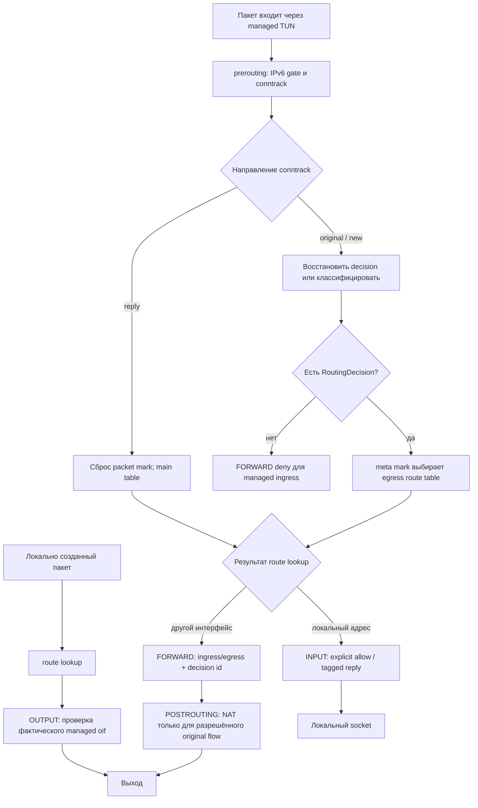

# nftables, маршрутизация и NAT в vpn-relay

Документ описывает реализацию в отдельном репозитории `lelikulibina/vpn-relay`.
Основные компоненты:

- `src/config.rs` — TOML-модель и валидация.
- `src/routing.rs` — единая модель routing decisions и генерация nftables.
- `src/linux/nftables.rs` — применение nftables, table ownership checks и transactional batch.
- `src/linux/policy_routing.rs` — применение и cleanup iproute2 policy routing с ownership checks.
- `src/linux.rs` — общие Linux-команды, interface identity, TUN link и rtnetlink.
- `src/runtime.rs` — startup/shutdown, блокировка экземпляра и sysctl.
- `src/backend/` — backend-neutral lifecycle и BoringTun WG/AWG backend.

## Путь пакета и порядок hooks

Ниже показан путь для managed TUN ingress. Локальный и транзитный трафик
разделяются после prerouting; OUTPUT проверяет фактический интерфейс,
выбранный маршрутизацией ядра.



Для OUTPUT пакетов conntrack host-flow tag выставляется только явным allow
правилом. INPUT/OUTPUT reply допускается только в reply direction при наличии
этого tag; одного `ct state established,related` недостаточно.

## Область управления

vpn-relay управляет только трафиком, который входит или выходит через
интерфейсы из `[interfaces]`. Таблица nftables имеет family `inet`,
настраиваемое имя `[daemon].nft_table` и table-level ownership comment
`managed by vpn-relay`.

INPUT, OUTPUT и FORWARD base chains используют `policy accept`: vpn-relay
не устанавливает глобальную политику хоста и не заменяет системный firewall.
Каждая цепочка ограничивает свои правила managed TUN интерфейсами. Поэтому
обычный физический/unmanaged ingress и egress не должны попадать под
vpn-relay deny rules. Остальные nftables base chains продолжают действовать
независимо; drop в другой base chain не отменяется accept в таблице vpn-relay.


### Фиксированные security defaults

Политики безопасности не переключаются конфигурационными флагами:

- INPUT: явные allow rules для managed ingress, затем deny для остального
  managed ingress;
- OUTPUT: явные allow rules для фактического managed TUN egress, затем deny
  для остального managed egress;
- FORWARD: разрешение только для потока с выбранным routing decision и
  соответствующей парой ingress/egress; unmatched и invalid managed traffic
  блокируется;
- NAT: применяется только к разрешённому original-direction FORWARD flow,
  выбранному тем же routing decision.

policy accept у base chains означает только то, что vpn-relay не меняет
глобальную политику host namespace. Это не отменяет локальный deny внутри
managed hooks. Отсутствие firewall allow rules эквивалентно deny для
соответствующего managed INPUT/OUTPUT направления. Отдельных параметров
input_policy, output_policy или forward_policy конфигурация не имеет.


## Конфигурационная модель

Направление определяется каждым routing rule, а не ролью интерфейса:

```toml
[[routing.rules]]
priority = 100
ingress = "wg-server"
source = ["10.10.0.0/24"]
destination = ["0.0.0.0/0"]
egress = "awg-primary"
nat = "masquerade"
```

`priority` задаёт порядок в пределах одного ingress; `ingress` и
`egress` — managed TUN интерфейсы; `source` и `destination` — необязательные
CIDR selectors. NAT поддерживает `none`, `masquerade` и статический `snat`
с обязательным `nat_to` для последнего.

Один интерфейс может участвовать в разных правилах и в разных направлениях.
Списки `source` и `destination` принимают только IPv4 CIDR. IPv6 selectors
отклоняются при загрузке конфигурации. Точные
повторяющиеся CIDR в одном списке отклоняются при загрузке конфигурации,
включая семантически одинаковые сети, записанные с разными host bits
(например, `10.10.0.0/24` и `10.10.0.99/24`). Пересекающиеся, но не
эквивалентные сети допустимы: для новых потоков применяется первое совпавшее
правило в порядке возрастания priority; уже классифицированные потоки
сохраняют conntrack decision своего первого пакета.

Самоссылочные правила запрещены. Приоритеты должны быть уникальны для одного
ingress. Первое совпавшее правило классифицирует новый flow; более поздние
правила для него уже не рассматриваются.

Firewall INPUT rules используют source CIDR, OUTPUT rules — destination CIDR.
Они могут ограничивать протокол (TCP, UDP, ICMP); порты допустимы
только для TCP/UDP. Эти allow rules относятся к host INPUT/OUTPUT, а не
заменяют routing rules для FORWARD.

## Conntrack и routing decision

У каждого уникального routing rule есть отдельный `RoutingDecision`, даже
если несколько решений используют один egress. Это необходимо, чтобы NAT и
обратный FORWARD использовали именно то правило, которое выбрало первый
пакет, а не повторно вычисляли совпадение по потенциально перекрывающимся
selectors.

- `meta mark` содержит routing mark egress и выбирает iproute2 table.
- Старшие 16 бит `ct mark` зарезервированы за vpn-relay.
- Диапазон `0x4001`–`0x4fff` содержит идентификаторы routing decisions;
  конфигурация ограничена 4095 routing rules.
- Значение `0x8000` помечает локальные host flows, прошедшие явное INPUT
  или OUTPUT разрешение.
- Младшие 16 бит `ct mark` сохраняются для host policy/QoS.

Для нового flow prerouting классифицирует пакет по ingress, source и
destination. При совпадении выставляются оба mark и выполняется return.
Для последующих пакетов original direction routing mark восстанавливается
из decision id в conntrack. Пакет reply direction получает нулевой packet
mark и использует main table для возврата к исходному ingress.

Routing marks выделяются только интерфейсам, которые реально используются
как egress. Для каждого egress создаются отдельные таблица маршрутизации,
default route и fwmark rule. Socket fwmarks — отдельный класс: для них
создаются правила с более высоким приоритетом, возвращающие внешний
зашифрованный WG/AWG UDP transport в main table.

## INPUT: host traffic с managed TUN

INPUT base chain:

1. Отбрасывает `ct state invalid` только для managed ingress.
2. Разрешает original-direction пакеты, совпавшие с явными
   `[firewall.input.rules]`.
3. Разрешает established/related reply-direction пакеты, только если
   conntrack entry имеет host-flow tag `0x80000000`, установленный явным
   OUTPUT allow rule для исходного host-initiated flow.
4. Отбрасывает весь остальной managed ingress.

Пакеты с unmanaged ingress и loopback не охватываются этими правилами.
INPUT allow rule не является разрешением FORWARD.

## OUTPUT: host traffic в managed TUN

INPUT/OUTPUT allow rules устанавливают host-flow tag, меняя только старшие
16 бит `ct mark` и сохраняя младшие 16. Поэтому established/related сам по
себе не является разрешением: reply на физическом интерфейсе или на flow,
не прошедший managed allow rule, не получает этот tag и не принимается через
managed TUN.

OUTPUT base chain:

1. Отбрасывает `ct state invalid` только при фактическом managed TUN egress.
2. Разрешает original-direction пакеты, совпавшие с явными
   `[firewall.output.rules]`.
3. Разрешает established/related reply-direction пакеты, только если
   conntrack entry имеет host-flow tag `0x80000000`, установленный явным
   INPUT allow rule для исходного client-initiated flow.
4. Отбрасывает остальной managed egress.

Проверяется фактический `oifname`, а не socket mark. Поэтому внешний
зашифрованный UDP, маршрутизируемый через физический/unmanaged интерфейс,
не должен попадать под managed OUTPUT deny.

## FORWARD: транзит между managed TUN и другими интерфейсами

Для FORWARD действует fail-closed модель:

- новый flow разрешается только если prerouting выбрал routing decision,
  а ingress/egress и routing mark совпадают с этим решением;
- original-direction established пакеты продолжают использовать сохранённый
  decision id и routing mark;
- reply-direction разрешается только в обратной паре egress → ingress и при
  совпадении decision id в conntrack;
- invalid пакеты с managed ingress отбрасываются;
- остаточные пакеты с managed ingress или managed egress отбрасываются.

Это не глобальный запрет unmanaged → unmanaged транзита. Такой трафик остаётся
вне области управления vpn-relay и подчиняется остальным firewall chains.

## NAT

NAT применяется только в postrouting и только к original-direction flow,
который уже получил routing decision. Правило NAT выбирается по точной паре
ingress/egress и decision id из conntrack:

- `none` — не выполнять трансляцию;
- `masquerade` — использовать адрес egress;
- `snat` — использовать явно заданный `nat_to`.

NAT не классифицирует flow повторно и не открывает доступ сам по себе.
Запрещённый FORWARD не получает разрешение из-за NAT. DNAT, REDIRECT и
port-forwarding этой моделью не предоставляются. Валидация проверяет
IPv4 тип `nat_to`; IPv6 SNAT не поддерживается.

## IPv4-only datapath и IPv6 isolation

`vpn-relay` поддерживает только IPv4. В конфигурации запрещены IPv6-адреса
TUN, IPv6 AllowedIPs, IPv6 endpoint literals, IPv6 routing/firewall selectors,
ICMPv6 и IPv6 SNAT. Отдельного переключателя dual-stack нет.

Для каждого управляемого TUN nftables устанавливает безусловные IPv6 drop
правила в `prerouting` по ingress interface, `forward` и `output`
по egress interface. Эти правила добавляются до разрешающих правил и не
зависят от conntrack state, поэтому блокируют в том числе established traffic.
При привязке к ifindex те же правила используют числовую identity исходного
TUN. Физические интерфейсы и UDP-сокеты BoringTun этими правилами не
фильтруются.

`vpn-relay` не создаёт IPv6 адреса или маршруты, не вызывает `ip -6`,
не создаёт IPv6 policy rules/NAT и не читает, не изменяет и не восстанавливает
IPv6 sysctl. Внешняя зависимость `boringtun-awg` не модифицируется этим
репозиторием; IPv4-only ограничение реализовано на уровне конфигурации,
маршрутизации и firewall `vpn-relay`.

**Граница packet-level coverage для IPv6:** реальные пакеты и nft counters
проверяют drop в output и forward при выборе managed TUN как egress.
Правило prerouting для managed-TUN ingress проверяется по сгенерированному
ruleset и unit assertions; отдельный packet-level ingress probe не заявляется.
Это ограничение явно сохраняется: IPv6 peers/AllowedIPs и IPv6 transport в
vpn-relay не поддерживаются, поэтому штатного IPv6 ingress datapath через
managed tunnel нет. PREROUTING drop остаётся дополнительной защитой от
неожиданно поступивших IPv6-пакетов, а не основанием утверждать, что
packet-level ingress тест уже выполнен.

## Peer identity и anti-spoofing

После расшифрования пакет поступает в TUN как обычный IP пакет. nftables
видит интерфейс и IP selectors, но не получает cryptographic peer identity.
Поэтому source CIDR в routing/firewall rule — это фильтр адреса, а не
самостоятельная проверка идентичности peer.

Внутренняя source-IP validation BoringTun после декапсуляции остаётся
без изменений. Она относится к tunnel backend, а не к IPv4-only модели
конфигурации vpn-relay. Исходный код внешней зависимости `boringtun-awg`
этим репозиторием не изменяется.


## Владение ресурсами и lifecycle

Перед изменением nftables backend проверяет точное family/name и table-level
ownership comment. Чужая таблица с тем же именем не заменяется и не удаляется.
Обновление таблицы выполняется одним `nft -f -` batch; delete/add в рамках
одного batch является транзакцией nftables.

Policy routing использует зарезервированный iproute2 protocol tag `242`.
Перед установкой проверяются конфликтующие rule priorities и таблицы.
Удаляются только ресурсы с ожидаемой identity.

Startup: instance lock для network namespace → nftables fail-closed policy →
создание TUN → IPv4 policy routes → IPv4 forwarding ownership. Legacy mode
управляет только namespace-wide IPv4 sysctl; per-interface mode сначала
проверяет IPv4 prerequisites и unmanaged links, затем сохраняет journal и
включает только allowlisted links.

Shutdown: остановка и join backend workers → удаление policy routes →
восстановление sysctl внешних интерфейсов при совпадении name/ifindex и
daemon-written value → удаление TUN links → удаление nftables policy. Записи
daemon-owned TUN не восстанавливаются: их sysctl исчезают вместе с
непостоянным TUN. При ошибке cleanup firewall остаётся установленным. Lock
удерживается до уничтожения Runtime.

**Режимы `manage_ip_forwarding`:**

- `false`: forwarding sysctl не меняются.
- `true` + пустой `forwarding_interfaces`: daemon управляет только
  namespace-wide `net.ipv4.ip_forward`.
- `true` + непустой `forwarding_interfaces`: daemon проверяет
  `net.ipv4.ip_forward=1`, проверяет forwarding на unmanaged IPv4 links
  и управляет только `net.ipv4.conf.<if>.forwarding` для allowlisted
  интерфейсов. IPv6 sysctl в обоих режимах не читаются и не меняются.

Startup сохраняет только исходные IPv4 значения в journal.
Shutdown/recovery восстанавливают их только при совпадении identity и
daemon-written value. Старые или неподдерживаемые версии journal отклоняются
до десериализации состояния и остаются на диске для ручной диагностики.

## Проверки и ограничения

Локальные Rust-тесты запускаются командой cargo test --locked --all-targets.
Они покрывают конфигурацию и импорт профилей, построение routing plan и
nftables rules, выделение mark space, проверку ownership, rtnetlink,
forwarding journal, control socket, rollback и BoringTun backend.

Интеграционные сценарии в scripts/ разделены по назначению:

- vpn-relay-netns-test.sh — namespace lifecycle, конфликтующие/чужие
  nftables и iproute2 ресурсы, startup rollback, fail-closed recovery и
  runtime reload с fault injection.
- vpn-relay-peer-traffic-test.sh wg|awg — реальные двунаправленные
  ICMP/TCP/UDP пакеты, INPUT/OUTPUT allow/deny, socket mark routing,
  reconnect и peer AllowedIPs update.
- vpn-relay-multi-uplink-test.sh — выбор uplink по selectors/priority,
  NAT, live policy changes и peer ownership/handoff.
- vpn-relay-per-interface-forwarding-test.sh — sysctl ownership,
  unmanaged-link isolation, drift detection, graceful restore и SIGKILL
  journal recovery.
- vpn-relay-per-interface-forwarding-packet-test.sh — реальный packet
  forwarding и IPv6 drop на managed TUN.
- vpn-relay-podman-container-test.sh — отдельный rootful Podman
  network namespace, capabilities, TUN, nftables и восстановление sysctl.

Два per-interface forwarding сценария не дублируют друг друга: первый
проверяет управление состоянием и восстановление, второй — прохождение
пакетов. Peer traffic запускается отдельно для WG и AWG, поскольку оба
backend должны проходить один и тот же datapath acceptance test.

В CI нет отдельного набора Rust-тестов с атрибутом #[ignore]; поэтому
запуск cargo test -- --ignored не нужен и не должен использоваться как
самостоятельный CI этап. Интеграционные проверки запускаются явными
скриптами. CI выполняет per-interface state/packet tests на Ubuntu 22.04 и
24.04, остальные namespace tests и Podman smoke test — на Ubuntu 24.04.

Packet-level IPv6 coverage намеренно ограничена: реальные пакеты и nft
counters проверяют drop в output и forward при выборе managed TUN как egress.
PREROUTING drop для managed-TUN ingress проверяется по сгенерированному
ruleset и unit assertions; отдельный packet-level ingress probe не заявлен.
Это соответствует IPv4-only модели: IPv6 peers/AllowedIPs и IPv6 transport
не поддерживаются.

Не следует считать peer-level isolation завершённой только на основании
interface-level selectors. Также необходимо продолжать проверять rollback
при конфликтующих nftables/iproute2 ресурсах, поведение с чужими base chains,
IPv4 routing/firewall/NAT и отказами IPv4 sysctl.
